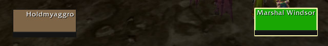

# Raid Style Frames

Replaces the default player, target and target-of-target frames with Blizzard's own raid-style (compact) frames: no portrait, no level, just the raid frame look. WoW Classic Era.

- Size, border and power bar follow your Raid Frame settings
- Target NPCs colored by reaction, players by class; combo points kept
- Target of target frame
- Buffs inside the frame, debuffs in a row below (with type-colored border and cooldown swipe)
- Move with Edit Mode or Shift+drag

